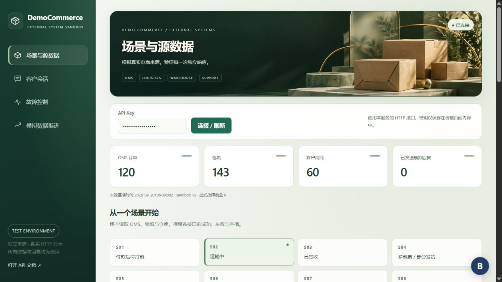

# DemoCommerce Sandbox 完整操作手册

适用版本：`sandbox-v2` 数据集及当前 Sandbox 控制台。更新日期：2026 年 10 月 13 日。

DemoCommerce Sandbox 提供一套虚构的电商外部系统，供人工演示和 HTTP 集成测试使用。你可以查看订单与包裹、读取物流与仓库记录、接收客户询问和追问、记录模拟回复、制造单个来源故障，以及手动推进来源数据。

所有消息、商品、物流和仓库信息均为测试数据。`SENT` 表示模拟 Support 系统接受了回复，不会真正给客户发消息。系统不生成 AI 答案，不执行退款、付款或真实发货，也不会自动把不同系统的状态合并成业务结论。

## 内容导航

- [启动服务](#2-启动服务)
- [首次使用和页面布局](#3-首次使用和页面布局)
- [场景与源数据](#4-场景与源数据)
- [客户会话](#5-客户会话)
- [故障控制](#6-故障控制)
- [模拟数据推进](#7-模拟数据推进)
- [完整操作演练](#8-完整操作演练)
- [重置和时间](#9-重置和时间)
- [HTTP 和 Swagger](#10-http-和-swagger)
- [全部接口](#11-全部接口)
- [字段与数据规则](#12-字段与数据规则)
- [错误处理](#13-错误处理)
- [脚本与验证](#14-脚本与验证)
- [持久化和常见问题](#15-持久化和常见问题)

## 1 服务用途

一个 FastAPI 服务通过独立 HTTP 接口模拟五类来源：

| 来源 | 可以做什么 |
|---|---|
| OMS 订单系统 | 查订单、查客户订单、查包裹；创建订单和包裹；修改订单状态与包裹分配 |
| Logistics 物流系统 | 查运单状态和事件；登记物流记录、修改当前状态、追加事件 |
| Warehouse 仓库系统 | 读取和追加原始仓库备注 |
| Support 客服接收系统 | 新建询问、接收追问、记录模拟回复、查询列表和会话历史 |
| Policy 规则来源 | 读取两条固定规则事实及其来源时间 |

订单、运单和询问是不同的记录，使用不同的 ID。查询顺序通常是：订单 ID → OMS 包裹列表 → 包裹中的运单号 → Logistics 运单和事件。仓库备注使用订单 ID 查询；客服会话使用询问 ID 查询。

来源之间保持独立。物流失败时仍可以读取 OMS 和仓库；追加物流事件不会自动更新运单状态；修改物流状态不会自动修改 OMS。外部应用应通过 HTTP 使用服务，不直接读取 SQLite 或导入本项目的内部代码。

基准环境如下，新增记录或回复后数量会变化：

| 项目 | 重置后的数量 |
|---|---:|
| 固定场景 | 12 |
| 订单 | 120 |
| 客户引用 | 60 |
| 商品 SKU | 20 |
| 包裹 | 143 |
| 物流记录 | 141 |
| 物流事件 | 539 |
| 仓库备注 | 120 |
| 客户询问 | 60 |
| 模拟回复 | 0 |
| 显式故障覆盖 | 0 |

客户和 SKU 是订单里的来源引用，当前没有独立的客户管理或商品管理界面。

## 2 启动服务

### 本地 Python 启动

需要 Python 3.12 或更高版本和 `uv`。在 PowerShell 中执行：

下面使用当前电脑的仓库路径；其他电脑请替换成实际目录。尚未下载仓库时，可先执行 `git clone https://github.com/Mark-UM/demo-commerce-sandbox.git`。

```powershell
Set-Location 'E:\system_folder\demo-commerce-sandbox'
uv sync --locked
uv run uvicorn app.main:app --host 127.0.0.1 --port 9000
```

看到 `Application startup complete` 后，保持终端运行，在浏览器打开：

| 地址 | 用途 |
|---|---|
| `http://127.0.0.1:9000/` | Sandbox 控制台 |
| `http://127.0.0.1:9000/docs` | Swagger 接口文档与交互调用 |
| `http://127.0.0.1:9000/openapi.json` | 机器可读的接口定义 |
| `http://127.0.0.1:9000/health` | 数据库和种子版本健康检查 |

本手册统一使用端口 **9000**。先前任务的临时预览可能运行在 **9010**，也可以使用，但浏览器地址、脚本 `--base-url` 和 HTTP 示例的基础地址必须一致。

第一次使用空数据库时会自动创建基准数据。后续启动保留已有数据，不会自动重置。默认数据库是启动目录中的 `sandbox.sqlite3`；按 `Ctrl+C` 停止服务。

### 配置密钥和数据库

在启动命令之前设置环境变量：

```powershell
$env:SANDBOX_API_KEY = 'your-local-test-key'
$env:SANDBOX_DB_PATH = 'E:\system_folder\demo-commerce-sandbox\sandbox.sqlite3'
uv run uvicorn app.main:app --host 127.0.0.1 --port 9000
```

未配置时，密钥默认是 `demo-commerce-key`。更改密钥后，需要重新启动服务，并在控制台或调用客户端输入同一个密钥。

Python 启动不会自动读取 `.env`；`.env.example` 只是配置示例。独立测试时可把 `SANDBOX_API_KEY` 显式设为空字符串以关闭服务鉴权。恢复默认值可以删除当前终端的覆盖：

```powershell
Remove-Item Env:SANDBOX_API_KEY -ErrorAction SilentlyContinue
```

API Key 是整个测试服务的凭据，不是客户身份或某个订单的访问权限。

### Docker 启动

Docker Engine 已运行时，在仓库目录执行：

```powershell
docker compose up --build -d --wait
docker compose logs -f sandbox-api
```

同样通过 `http://127.0.0.1:9000/` 使用。日志查看命令中的 `Ctrl+C` 只退出日志跟随，不会停止容器。

| 命令 | 结果 |
|---|---|
| `docker compose restart` | 重启服务，保留数据 |
| `docker compose down` | 停止并移除容器，保留数据卷 |
| `docker compose up -d --wait` | 再次启动，继续使用数据卷 |
| `docker compose down -v` | 同时删除数据卷，清除当前测试数据 |

Compose 将数据库固定存放在容器的 `/data/sandbox.sqlite3`，使用 `sandbox-data` 数据卷。Compose 会读取 `.env` 中的密钥配置；按当前 Compose 配置，空密钥会回退为 `demo-commerce-key`，不能用空 `.env` 值关闭容器鉴权。宿主机的 `SANDBOX_DB_PATH` 不会改变该容器内路径。

## 3 首次使用和页面布局



打开控制台后，页面自动使用默认演示密钥连接。如果服务配置了其他密钥，修改 **API Key**，点击 **连接 / 刷新**。

连接徽标分别显示“连接中”“已连接”或“连接失败”。密钥只保存在当前页面内存中；重新加载页面会回到演示默认值，自定义密钥需要重新输入。

页面由共同顶部区域和四个功能页面组成：

| 区域 | 操作与含义 |
|---|---|
| 顶部连接区 | 输入密钥，连接或刷新环境；刷新也会更新当前打开的会话并保留同会话草稿 |
| 四张统计卡 | 当前订单、包裹、询问和已接受模拟回复数量 |
| 来源基准时间 | 当前种子时钟 `T0`、数据版本和显式故障覆盖数量 |
| 场景与源数据 | 选择 S01–S12，查订单与各来源，查客户订单，查看 Policy |
| 客户会话 | 筛选询问、查看历史、接收客户消息和手动提交回复 |
| 故障控制 | 配置、查看、编辑和清除物流或仓库故障覆盖 |
| 模拟数据推进 | 执行八类来源写入，或重置环境 |

顶部背景和线条图标只用于视觉展示，不代表订单状态，也不是额外的操作入口。界面适配手机；系统开启“减少动态效果”时会减少动画和滚动过渡。

页面没有持续轮询。外部脚本修改数据后，使用 **连接 / 刷新**、对应列表的刷新按钮、**检查源数据**或单个面板的 **重试**，重新读取来源。

## 4 场景与源数据

### 检查一个订单

1. 点击左侧 **场景与源数据**。
2. 点击某个 S01–S12 场景卡片；或者输入订单 ID，点击 **检查源数据**。
3. 分别查看 OMS 订单、Warehouse 备注、OMS 包裹引用。
4. 对每个有运单号的包裹，页面分别请求 Logistics 当前状态与 Events 事件列表。
5. 点击某个面板的 **重试**，只重新读取该接口。包裹引用重试还会按照最新包裹引用重新建立物流面板。

每个接口都有自己的状态，不要只根据一个面板判断整张订单是否可读取。读取成功的 JSON 中，`null` 表示未知，`[]` 表示该列表为空，404 表示所查询的记录不存在。

如果包裹的运单号为 `null`，页面会说明无法请求物流来源。这与已有运单号但物流记录返回 404 的情况不同。

### 固定场景说明

以下是**重置后且未设置显式故障覆盖**时的行为。每个场景的会话 ID 为 `INQ-DEMO-NNN`；对应订单 ID 为 `ORD-DEMO-NNN`，其中 `NNN` 是三位数字。

| 场景 | 订单 ID | 观察重点 | 基准结果 |
|---|---|---|---|
| S01 付款后待打包 | `ORD-DEMO-001` | `PAID`，尚无包裹 | OMS、仓库 200；包裹 `[]` |
| S02 运输中 | `ORD-DEMO-002` | `SHIPPED`，物流 `IN_TRANSIT` | 各来源 200 |
| S03 已签收 | `ORD-DEMO-003` | 订单与物流已签收 | 各来源 200 |
| S04 多包裹部分发货 | `ORD-DEMO-004` | 两个包裹；一个运输中，一个待揽收 | 两套物流面板，分别返回 200 |
| S05 等待补货 | `ORD-DEMO-005` | `WAITING_STOCK`，仓库更新时间未知 | 包裹 `[]`；备注 `updated_at: null` |
| S06 已打包待揽收 | `ORD-DEMO-006` | `PACKED`，物流 `NOT_COLLECTED` | 200；标签创建不等于已经揽收 |
| S07 物流长时间未更新 | `ORD-DEMO-007` | 物流更新时间为 `T0` 前 72 小时 | 200，原样保留旧来源时间 |
| S08 物流接口超时 | `ORD-DEMO-008` | 运单 `TRK-DEMO-008-1` | 物流状态和事件 504；OMS、仓库 200 |
| S09 仓库接口不可用 | `ORD-DEMO-009` | 仓库读取失败 | 仓库 503；OMS、物流 200 |
| S10 物流记录缺失 | `ORD-DEMO-010` | OMS 有运单引用，但物流记录不存在 | 物流状态和事件 404；OMS、仓库 200 |
| S11 仓库与物流冲突 | `ORD-DEMO-011` | 仓库说未交运，物流说已揽收 | 200，同时保留两份冲突事实 |
| S12 订单不存在 | `ORD-DEMO-012` | 订单缺失，但询问存在 | 订单、包裹、仓库 404；询问 200 |

通常运单号为 `TRK-DEMO-NNN-1`、包裹号为 `PAR-DEMO-NNN-1`。S04 另有 `TRK-DEMO-004-2` 和 `PAR-DEMO-004-2`。S01、S05 没有包裹；S12 没有订单。以实际 OMS 包裹列表为准，避免凭订单号猜测运单是否存在。

**查看场景会话**会打开当前 S01–S12 对应的询问。自建订单或普通订单没有这种固定映射；应到 **客户会话**中按订单筛选或输入实际询问 ID。

### 其他现成测试数据

| ID | 可以验证的情况 |
|---|---|
| `ORD-DEMO-101` 至 `ORD-DEMO-209` | 109 张普通订单，可查看不同状态和多包裹 |
| `INQ-DEMO-101` 至 `INQ-DEMO-148` | 48 条普通询问 |
| `ORD-DEMO-105` | 仓库备注含类似指令的文本，始终按来源数据展示 |
| `INQ-DEMO-106` | 客户提出退款诉求，系统仍只接收消息，不执行退款 |
| `INQ-DEMO-107` | 询问没有订单关联 |
| `ORD-DEMO-110` | 已打包，但包裹承运商与运单号尚未分配 |
| `TRK-DEMO-113-1` | 物流当前状态存在，事件列表为空 |

### 通过客户 ID 查订单

展开 **通过客户 ID 查找订单**，输入例如 `CUS-DEMO-002`，点击 **查找订单**。点击结果里的订单按钮即可检查该订单来源。

页面每页显示 10 个订单，使用 **上一页**和 **下一页**翻页。客户识别依据是订单中的 `customer_reference`；不存在任何对应订单的客户引用返回 404。改筛选条件后先重新点击 **查找订单**。

### 查看规则事实

展开 **查看 Policy 原始事实**，读取两条规则及其 `updated_at`。这里只展示原文，不检索知识库、不解释规则，也不据此自动回复。

## 5 客户会话

### 查找和打开询问

1. 点击 **客户会话**。
2. 选择 **待回复**、**已回复**或**全部**；需要时填写订单筛选。
3. 点击 **刷新会话列表**。订单筛选是精确匹配，不是关键词搜索。
4. 列表每页 10 条，按询问 ID 排序。使用上一页和下一页翻页。
5. 点击某条询问，或者在 **会话 ID**里填写完整 ID 并点击 **打开**。

新建的询问使用生成的 ID，不保证排在第一页或列表顶部；提交成功后页面会自动打开新会话。需要再次查找时，记录其实际 ID或按订单筛选。

会话顶部展示状态、关联订单、来源更新时间以及**当前最新客户消息**。历史按系统接受消息的顺序展示，客户消息与模拟客服回复分别标识。每次先加载 50 条；出现 **加载后续消息**时继续点击，直到按钮消失。

| 状态 | 含义 |
|---|---|
| `OPEN` 待回复 | 最新接受的会话消息来自客户 |
| `REPLIED` 已回复 | 最新接受的会话消息来自 Support |
| `SENT` 回复回执 | 模拟接收系统已接受该回复 |

这些状态不代表真实投递、工单解决或产品审批。新追问会把 `REPLIED` 重新变成 `OPEN`。

### 新建客户询问

展开 **新建客户询问**，填写客户消息和可选订单 ID，点击 **接收客户询问**。

订单 ID可以留空，也可以引用不存在的订单。引用只是客户提供的数据，服务不会把它当成订单存在或访问授权的证明。成功后返回新的 `INQ-...` 询问 ID 和首条客户消息 ID，页面会打开该会话。

消息必须包含非空白内容，最多 10,000 个字符。接收时间由系统使用当前 UTC 时间记录。

### 接收客户追问

在已打开的会话中，把 **操作类型**改成 **接收客户追问**。填写消息后，选择订单关联方式：

| 选择 | 请求含义 | 结果 |
|---|---|---|
| 保留当前订单 | 不提交 `order_id` 字段 | 保留原来的订单关联 |
| 清除订单关联 | 提交 `order_id: null` | 移除订单关联 |
| 改为下方订单 | 提交新订单 ID 字符串 | 改成输入的新订单关联 |

选择“改为下方订单”时还要填写 **新的订单 ID**。点击 **提交消息**，历史追加一条客户消息，最新客户文本和消息 ID 更新，状态回到 `OPEN`。原始询问的 `created_at` 不会改成追问时间。

### 提交模拟客服回复

把 **操作类型**改成 **发送模拟客服回复**，阅读最新客户消息，手动填写回复，点击 **提交消息**。

控制台自动把回复绑定到读取到的 `latest_customer_message_id`。成功后状态变成 `REPLIED`，历史新增 Support 消息，并显示“回复绑定”的客户消息 ID。

如果在阅读与提交之间收到另一条客户追问，新的旧绑定回复返回 **409 CUSTOMER_MESSAGE_CHANGED**。控制台刷新最新会话并保留草稿。重新阅读最新消息，修改或确认草稿后再次提交。切换到另一条会话时，旧会话草稿会清空。

### 重试和幂等

控制台为新询问、追问、回复自动生成幂等键。发生连接中断等不确定错误时，同一页面重试相同路径和内容，会沿用尚未完成请求的键，防止重复接收。

成功提交后，该键不再用于下一条新消息。刷新或关闭页面会丢失页面内的重试键。若需要跨页面、跨进程可靠重试，使用 HTTP 调用并自行保存幂等键。

已接受的旧回复重试只返回原回执，不会关闭后来出现的新追问。相同键却改了文本或绑定，会返回 `IDEMPOTENCY_CONFLICT`；新的真实消息或回复应使用新的键。

## 6 故障控制

### 配置一个覆盖

1. 点击 **故障控制**。
2. 选择 **Logistics 物流**或 **Warehouse 仓库**。
3. 物流的来源记录 ID 填运单号，例如 `TRK-DEMO-004-1`；仓库填订单号，例如 `ORD-DEMO-009`。
4. 选择模式。只有 `SLOW_RESPONSE` 需要填写正的延迟值。
5. 点击 **应用覆盖**，再到 **场景与源数据**重新检查或重试接口。

物流目标必须已有物流记录；不能给 S10 缺失的运单直接加故障。仓库控制要求订单存在，使用订单 ID，而不是备注 ID。每条规则只作用于指定系统和记录。

### 全部模式

| 模式 | 实际效果 | 使用方式 |
|---|---|---|
| `NORMAL` | 返回原始来源数据，覆盖 S08、S09 等内置故障 | 暂时恢复来源正常读取 |
| `TIMEOUT_ONCE` | 仅下一个相关请求返回 504，然后恢复正常 | 验证首次失败后重试 |
| `ALWAYS_TIMEOUT` | 每次立即返回模拟上游 504 | 验证持续不可用；不是等待到客户端超时 |
| `HTTP_500` | 每次返回 500 | 验证上游服务错误 |
| `HTTP_429` | 每次返回 429，响应头 `Retry-After: 1` | 验证限流处理 |
| `SLOW_RESPONSE` | 延迟 1–10,000 毫秒，再返回数据 | 验证慢响应或调用方自己的读取超时 |
| `STALE_DATA` | 已知来源时间再向前移动 72 小时，保留 null | 验证旧数据；HTTP 仍为 200 |
| `EMPTY_RESULT` | 事件或备注为 `[]`；运单保留身份但状态和更新时间为 null | 验证合法的空来源 |
| `PARTIAL_FAILURE` | 此来源记录返回 503，其他记录不受影响 | 验证单个包裹失败 |
| `CONFLICTING_DATA` | 仓库说未交给承运商；物流状态或事件显示 `PICKED_UP` | 验证来源事实冲突 |
| `MALFORMED_RESPONSE` | HTTP 200，但发送不完整 JSON | 验证解析失败；控制台明确标错 |

`SLOW_RESPONSE` 以外的模式要求 `delay_ms` 为 0。故障控制不自动重试，也不修改数据库里原有的来源事实；数据修改模式只改变读取响应。

**TIMEOUT_ONCE 的重要规则：**同一运单的状态与事件共享一次失败预算。控制台并行请求两者，哪一个先抵达就消耗预算，所以可能状态 504、事件 200，也可能相反。重新点击 **应用覆盖**会把预算重新设为 1。之后点击 **刷新覆盖**可查看剩余次数从 1 变为 0。

控制台单请求超时为 20 秒，而慢响应最大延迟为 10 秒。仅设置慢响应通常不会使控制台自身超时。要验证真实客户端超时，使用更短的调用方超时，见第 10 节。

### 编辑和移除覆盖

**当前显式覆盖**只列出人工配置过的规则，不列出内置的 S08、S09 故障。列表为空不代表所有来源正常。

点击 **编辑此覆盖**会把系统、记录、模式和延迟填回表单；修改后点击 **应用覆盖**。点击 **刷新覆盖**读取最新配置和消耗次数。

点击 **移除覆盖**恢复该记录的基准行为，重复移除仍成功。因此，移除 S08 的覆盖后会再次得到 504，移除 S09 的覆盖后会再次得到 503。想让这些记录正常，需要应用 `NORMAL`。

故障规则和已消耗的一次失败预算会跨重启保留，重置环境才会清除。

## 7 模拟数据推进

### 共通操作步骤

进入 **模拟数据推进**，选择操作，填写需要的 **目标记录 ID**，编辑 **请求 JSON**，然后点击 **执行来源写入**。右侧展示来源返回的记录，创建成功为 201，修改成功为 200。

操作选择器会生成示例 JSON。**切换操作会覆盖编辑内容**；修改目标 ID 只修改请求路径，不会自动修改 JSON 里的 `order_id`、`parcel_id` 等关联字段。请同步检查路径和正文。

以下八份 JSON 使用同一组教学 ID。先完成“新建订单”，再创建包裹、分配运单和登记物流；其余修改按需执行。每个 ID 只创建一次。要重新演练，重置环境或换一组新的 ID。

### 新建订单

前端操作：**OMS · 新建订单**。无需目标记录 ID。

HTTP：`POST /api/admin/oms/orders`，成功 201。

```json
{
  "order_id": "ORD-GUIDE-001",
  "customer_reference": "CUS-GUIDE-001",
  "status": "PAID",
  "items": [
    {"sku": "DEMO-MUG", "product_name": "演示旅行杯", "quantity": 1}
  ],
  "created_at": "2026-10-13T06:00:00Z",
  "updated_at": null
}
```

订单状态是来源字符串，不是付款或发货流程。创建后可在来源页面查 `ORD-GUIDE-001`，或通过客户 `CUS-GUIDE-001` 查订单。

### 更新订单状态

前端操作：**OMS · 更新订单状态**；目标记录 ID：`ORD-GUIDE-001`。

HTTP：`PATCH /api/admin/oms/orders/ORD-GUIDE-001`，成功 200。

```json
{
  "status": "SHIPPED",
  "updated_at": "2026-10-13T06:10:00Z"
}
```

这只修改 OMS。要把订单改为已签收，可另行提交 `status: "DELIVERED"` 及对应来源时间；物流不会随之自动改变。

### 新建包裹

前端操作：**OMS · 新建包裹**；目标记录 ID：`ORD-GUIDE-001`。

HTTP：`POST /api/admin/oms/orders/ORD-GUIDE-001/parcels`，成功 201。

```json
{
  "parcel_id": "PAR-GUIDE-001",
  "order_id": "ORD-GUIDE-001",
  "carrier": null,
  "tracking_number": null,
  "updated_at": null
}
```

订单必须存在，正文订单 ID 必须与路径一致。包裹 ID 在整个环境中不能重复。多包裹订单可以在同一订单下重复调用，但每次使用不同包裹 ID，并填写实际分配的运单。

### 更新包裹分配

前端操作：**OMS · 更新包裹分配**；目标记录 ID：`PAR-GUIDE-001`。

HTTP：`PATCH /api/admin/oms/parcels/PAR-GUIDE-001`，成功 200。

```json
{
  "carrier": "DemoExpress",
  "tracking_number": "TRK-GUIDE-001",
  "updated_at": "2026-10-13T06:05:00Z"
}
```

目标是**包裹 ID**。运单不能分配给另一个包裹；已经登记物流记录的包裹不能换运单。分配后点包裹面板 **重试**会发现新引用；尚未登记物流时，新物流面板返回 404 属于正常的来源缺失。

### 登记物流记录

前端操作：**Logistics · 登记物流记录**。无需目标记录 ID。

HTTP：`POST /api/admin/logistics/shipments`，成功 201。

```json
{
  "tracking_number": "TRK-GUIDE-001",
  "parcel_id": "PAR-GUIDE-001",
  "status": "NOT_COLLECTED",
  "updated_at": "2026-10-13T06:05:00Z"
}
```

包裹必须存在，运单号必须与 OMS 当前分配一致。登记成功后当前状态可以读取；未追加事件时事件列表为 `[]`。

### 更新物流状态

前端操作：**Logistics · 更新物流状态**；目标记录 ID：`TRK-GUIDE-001`。

HTTP：`PATCH /api/admin/logistics/shipments/TRK-GUIDE-001`，成功 200。

```json
{
  "status": "IN_TRANSIT",
  "updated_at": "2026-10-13T06:15:00Z"
}
```

目标是**运单号**。物流状态是明确存储的值，不根据事件推算，也不会自动改 OMS。

### 追加物流事件

前端操作：**Logistics · 追加物流事件**；目标记录 ID：`TRK-GUIDE-001`。

HTTP：`POST /api/admin/logistics/shipments/TRK-GUIDE-001/events`，成功 201。

```json
{
  "event_id": "EVT-GUIDE-001",
  "parcel_id": "PAR-GUIDE-001",
  "status": "IN_TRANSIT",
  "description": "包裹进入演示运输节点。",
  "occurred_at": "2026-10-13T06:15:00Z",
  "updated_at": null
}
```

物流记录必须存在，事件的包裹 ID 必须与该物流记录一致。事件 ID 不能重复。只追加一个 `DELIVERED` 事件不会把当前物流状态变成 `DELIVERED`；需要另外调用更新物流状态。

### 追加仓库备注

前端操作：**Warehouse · 追加仓库备注**；目标记录 ID：`ORD-GUIDE-001`。

HTTP：`POST /api/admin/warehouse/orders/ORD-GUIDE-001/notes`，成功 201。

```json
{
  "note_id": "NOTE-GUIDE-001",
  "order_id": "ORD-GUIDE-001",
  "text": "已完成打包，等待演示承运商揽收。",
  "created_at": "2026-10-13T06:02:00Z",
  "updated_at": null
}
```

订单必须存在，备注订单 ID 与路径一致，备注 ID 不能重复。文本不会被执行或解释，追加备注也不会触发发货。

八类来源写入都没有 `idempotency_key` 字段。重复创建同一 ID 返回 409，修改相同值可以再次执行，重复追加同一事件或备注 ID 返回 409。如果写入连接中断，先读取来源确认是否已接受，再决定重试。

故障覆盖只影响来源读取，不阻止这些来源写入。因此可以先在故障期间更新记录，再恢复读取验证新事实。

## 8 完整操作演练

### 观察多包裹和独立故障

1. 打开 S04，确认两个包裹和两套物流面板。
2. 在故障控制中，对 `TRK-DEMO-004-1` 应用 `PARTIAL_FAILURE`。
3. 回到 S04 检查来源。第一个包裹物流状态和事件为 503，第二个包裹仍为 200，OMS 与仓库仍可读取。
4. 移除该覆盖，重新读取，恢复原来的两套正常响应。

### 验证首次失败后恢复

1. 对 `TRK-DEMO-002-1` 应用 `TIMEOUT_ONCE`。
2. 检查 S02：物流状态或事件中有且只有一个请求返回 504。
3. 点击失败面板 **重试**，该请求恢复 200。
4. 到故障控制点 **刷新覆盖**，确认剩余次数为 0。
5. 再次应用同一模式会重新制造一次失败；移除覆盖恢复基准。

### 从客户询问推进到运输

1. 按第 7 节创建 `ORD-GUIDE-001`，初始为 `PAID`。
2. 在客户会话新建询问，关联该订单，消息填“我的订单发货了吗”。记录生成的实际询问 ID。
3. 手动回复“目前订单处于演示打包阶段”，确认会话变为 `REPLIED`。
4. 接收客户追问“承运商已经揽收了吗”，保留订单关联，确认变回 `OPEN`。
5. 创建并分配 `PAR-GUIDE-001`，登记 `TRK-GUIDE-001`。
6. 分别更新 OMS 为 `SHIPPED`、物流为 `IN_TRANSIT`，追加运输事件和仓库备注。
7. 在来源页面重新检查该订单，逐个核对来源返回的事实。
8. 打开实际询问，阅读最新消息，再提交一条针对该消息的回复。

要继续演练签收，应另行更新物流为 `DELIVERED`、追加唯一 ID 的签收事件、更新 OMS 为 `DELIVERED`。没有自动联动步骤。

### 验证并发追问

在两个浏览器页面打开同一个询问。页面 A 保留一份回复草稿；页面 B 接收一条新的客户追问。A 不刷新直接提交，将得到 409，自动更新最新会话，并保留草稿。读完新消息后再提交，绑定会更新。

这些演练会改变测试环境。结束后可以重置，恢复固定场景。

## 9 重置和时间

### 前端重置

在 **模拟数据推进**底部展开 **重置整个测试环境**：

1. 选择固定基准或当前 UTC 时间。
2. 确认其他操作已经结束。
3. 勾选 **我确认清除当前测试数据**。
4. 点击 **重置环境**。

固定基准是 `2026-09-20T06:00:00Z`。当前 UTC 选项使用点击时的浏览器当前时间作为新的种子参考时间，所以测试机器的系统时钟需要正确。

重置恢复 120 张订单、60 条初始询问等基准数据；移除自建记录、追问、模拟回复、所有幂等记录和显式故障覆盖；清空当前会话与旧写入结果。服务保持运行，静态背景图片和密钥配置不会被删除或改变。

**S08 的 504、S09 的 503 会恢复**，这是固定场景设计。重置后之前接受过的幂等键也可在新测试运行中创建新记录。

控制台会阻止同一页面内正在进行其他表单操作时重置，但无法知道其他页面、脚本或外部客户端是否仍在运行。服务不会取消在途请求；请先完成旧测试请求再重置。

### HTTP 重置

`POST /api/admin/reset` 必须发送 JSON 对象：

```json
{}
```

空对象或 `{"base_time": null}` 使用固定基准。选择明确参考时间时发送：

```json
{"base_time": "2026-10-13T06:00:00Z"}
```

成功 200，返回 `status: "RESET"`、`seed_version: "sandbox-v2"` 和实际 `base_time`。验证失败为 422，数据不改变。重置时间必须是 UTC 的 `Z` 或 `+00:00` 格式；无时区、非零时区偏移和数值时间均不接受。

### 离线命令重置

停止 Python 服务后，在同一个仓库目录、同一数据库路径配置下执行：

```powershell
uv run python -m app.reset
```

或指定 UTC 基准：

```powershell
uv run python -m app.reset --base-time 2026-10-13T06:00:00Z
```

然后重新启动。Docker 数据库在容器数据卷中，不要用宿主机默认的 CLI 命令误以为重置了容器；运行中的容器使用 HTTP 重置即可。

### 正确理解来源时间

`T0` 是生成基准记录的参考时间，不是最后一次查询时间。默认数据使用固定历史日期，不随启动或查询时间更新。

正常物流更新时间通常是 `T0` 前 10 分钟，S07 为 `T0` 前 72 小时。更换重置基准会平移已知种子时间，保持相对时间、状态、稳定 ID 和 null；已有真实接收消息会被清除。

客户新消息和回复的接受时间使用当前服务 UTC 时间。手动来源写入使用你提供的时间。服务不添加 `fetched_at`，也不判断数据是否“新鲜”。时间敏感演练可以选择当前 UTC 基准；固定时间回归测试应保持固定基准。

## 10 HTTP 和 Swagger

### Swagger 操作

打开 `/docs`，点击 **Authorize**，在 `X-API-Key` 输入框填当前服务密钥并授权。展开接口，点击 **Try it out**，填写路径、查询参数和请求 JSON，点击 **Execute**。

查看实际请求 URL、HTTP 状态、Response body 和响应头。框架展示的模型比旧参考计划更接近当前实现；`/openapi.json` 和 [当前契约](api-contract.md) 是接口依据。

### PowerShell 调用工具

在另一个 PowerShell 终端执行以下定义。密钥和端口应与当前服务一致。函数将 JSON 编码为 UTF-8，避免中文在不同 PowerShell 版本下被错误编码。

```powershell
$SandboxBase = 'http://127.0.0.1:9000'
$SandboxHeaders = @{ 'X-API-Key' = 'demo-commerce-key' }

function Invoke-Sandbox {
    param(
        [Parameter(Mandatory = $true)]
        [ValidateSet('GET', 'POST', 'PUT', 'PATCH', 'DELETE')]
        [string]$Method,
        [Parameter(Mandatory = $true)]
        [string]$Path,
        [object]$Body
    )
    $request = @{
        Method = $Method
        Uri = "$SandboxBase$Path"
        Headers = $SandboxHeaders
    }
    if ($PSBoundParameters.ContainsKey('Body')) {
        $json = ConvertTo-Json -InputObject $Body -Depth 20
        $request.ContentType = 'application/json; charset=utf-8'
        $request.Body = [System.Text.Encoding]::UTF8.GetBytes($json)
    }
    Invoke-RestMethod @request
}
```

使用示例：

```powershell
Invoke-Sandbox GET '/health'
Invoke-Sandbox GET '/api/admin/summary'
Invoke-Sandbox GET '/api/oms/orders/ORD-DEMO-002'
Invoke-Sandbox GET '/api/oms/orders/ORD-DEMO-002/parcels'
Invoke-Sandbox GET '/api/logistics/shipments/TRK-DEMO-002-1'
Invoke-Sandbox GET '/api/logistics/shipments/TRK-DEMO-002-1/events'
Invoke-Sandbox GET '/api/warehouse/orders/ORD-DEMO-002/notes'
Invoke-Sandbox GET '/api/policy/order-support'
```

来源写入时，把第 7 节对应 JSON 转成对象，并使用该节给出的 Method 和 Path：

```powershell
$body = @'
{"status":"IN_TRANSIT","updated_at":"2026-10-13T06:15:00Z"}
'@ | ConvertFrom-Json
Invoke-Sandbox PATCH '/api/admin/logistics/shipments/TRK-GUIDE-001' $body
```

这里的运单必须已按教学步骤登记。路径变量中包含特殊字符时，对该 ID 做 URL 编码；查询参数同样需要编码。

### 客户消息与回复调用

以下示例直接创建一条关联 S02 的询问，因此不依赖教学订单是否创建：

```powershell
$inquiry = Invoke-Sandbox POST '/api/support/inquiries' @{
    customer_message = '我的演示订单现在到哪里了？'
    order_id = 'ORD-DEMO-002'
    idempotency_key = 'guide-inquiry-1'
}
$inquiryPath = "/api/support/inquiries/$($inquiry.inquiry_id)"

$replyCommand = @{
    text = '这是一条手动填写的模拟回复。'
    idempotency_key = 'guide-reply-1'
    in_reply_to_message_id = $inquiry.latest_customer_message_id
}
Invoke-Sandbox POST "$inquiryPath/replies" $replyCommand
Invoke-Sandbox POST "$inquiryPath/replies" $replyCommand

Invoke-Sandbox POST "$inquiryPath/messages" @{
    text = '我还有一个新的追问。'
    idempotency_key = 'guide-followup-1'
}
$latest = Invoke-Sandbox GET $inquiryPath
Invoke-Sandbox POST "$inquiryPath/replies" @{
    text = '这是针对最新追问的模拟回复。'
    idempotency_key = 'guide-reply-2'
    in_reply_to_message_id = $latest.latest_customer_message_id
}
Invoke-Sandbox GET "$inquiryPath/messages?limit=50&offset=0"
Invoke-Sandbox GET "$inquiryPath/replies?limit=50&offset=0"
```

第一次回复和紧接着的同键重试返回相同回执，只产生一条 Support 消息。追问后必须重新读取最新消息 ID，再用新的回复键。此示例的固定键适合一次教学运行；重跑前重置，或为新的逻辑消息换键。旧请求重放可能返回最初回执而不是当前会话状态，应另外 GET 读取当前状态。

| 命令 | 成功返回 |
|---|---|
| 新建询问 | 201，原始 Inquiry 接收记录，含生成的询问和消息 ID |
| 客户追问 | 201，原始 CUSTOMER 消息接收记录 |
| 模拟回复 | 200，`reply_id`、`status: SENT`、`sent_at` |
| 消息历史 | CUSTOMER 与 SUPPORT 的统一数组，含回复绑定 |
| 回复历史 | 只包含已接受回复的数组，含原文、幂等键、时间；不含消息绑定字段 |

HTTP 回复允许省略 `in_reply_to_message_id` 以兼容旧客户端，但这样没有防止并发追问的保护。新调用应始终提供最新客户消息 ID。

幂等键范围分别是：新询问入口、某条询问的客户追问、某条询问的回复。键最多 200 个字符，文本最多 10,000 个字符，均不能是空白。重启保留去重记录；重置清除它们。

### 故障与重置调用

```powershell
Invoke-Sandbox PUT '/api/admin/scenarios/logistics/TRK-DEMO-004-1' @{
    mode = 'TIMEOUT_ONCE'
    delay_ms = 0
}
Invoke-Sandbox GET '/api/admin/scenarios'
Invoke-Sandbox DELETE '/api/admin/scenarios/logistics/TRK-DEMO-004-1'

Invoke-Sandbox PUT '/api/admin/scenarios/warehouse/ORD-DEMO-009' @{
    mode = 'NORMAL'
    delay_ms = 0
}
```

DELETE 成功是 204，没有 JSON 正文，所以 PowerShell 可能没有输出。要恢复原来的 S09 503，再 DELETE 该仓库覆盖。

下面的命令会清除测试数据，确认其他测试结束后再执行：

```powershell
Invoke-Sandbox POST '/api/admin/reset' @{}
Invoke-Sandbox POST '/api/admin/reset' @{ base_time = '2026-10-13T06:00:00Z' }
```

### 验证真正的客户端超时

设置比调用方超时更长的来源延迟：

```powershell
Invoke-Sandbox PUT '/api/admin/scenarios/logistics/TRK-DEMO-002-1' @{
    mode = 'SLOW_RESPONSE'
    delay_ms = 2000
}
curl.exe --max-time 1 -H 'X-API-Key: demo-commerce-key' 'http://127.0.0.1:9000/api/logistics/shipments/TRK-DEMO-002-1'
```

调用方在约一秒超时，来源延迟两秒；这与 `ALWAYS_TIMEOUT` 立即返回 HTTP 504 不同。等待延迟请求结束后，用 DELETE 清除该覆盖。

### 列表分页

HTTP 列表默认 `limit=50`，允许 1–100；`offset` 从 0 开始，必须非负。返回裸数组，不提供总数包裹对象。

```powershell
Invoke-Sandbox GET '/api/oms/customers/CUS-DEMO-002/orders?limit=10&offset=0'
Invoke-Sandbox GET '/api/support/inquiries?status=OPEN&order_id=ORD-DEMO-002&limit=10&offset=0'
Invoke-Sandbox GET '/api/support/inquiries?limit=10&offset=10'
```

询问先筛选再分页。客户订单和询问按 ID 排序；消息和回复按接受顺序排列。脚本应逐页增加 offset，读到 `[]` 后停止。询问不传 status 表示全部状态；不传 order_id 表示不按订单筛选。

## 11 全部接口

以下列出全部 **28 个接口操作**。`{order_id}`、`{parcel_id}`、`{tracking_number}`、`{inquiry_id}` 等是路径变量，需要替换成实际 ID。所有 `/api/` 操作使用同一个 `X-API-Key`。

### 读取接口

| Method | Path | 参数或返回内容 |
|---|---|---|
| GET | `/health` | 健康状态、数据库状态和种子版本；公开 |
| GET | `/api/oms/orders/{order_id}` | 订单与商品项 |
| GET | `/api/oms/orders/{order_id}/parcels` | 包裹数组 |
| GET | `/api/oms/customers/{customer_id}/orders` | 客户订单数组；limit、offset |
| GET | `/api/logistics/shipments/{tracking_number}` | 当前物流状态 |
| GET | `/api/logistics/shipments/{tracking_number}/events` | 物流事件数组 |
| GET | `/api/warehouse/orders/{order_id}/notes` | 原始备注数组 |
| GET | `/api/policy/order-support` | facts 数组及各事实来源时间 |
| GET | `/api/support/inquiries` | 询问数组；limit、offset、order_id、status |
| GET | `/api/support/inquiries/{inquiry_id}` | 当前询问与最新客户消息 |
| GET | `/api/support/inquiries/{inquiry_id}/messages` | 统一消息历史；limit、offset |
| GET | `/api/support/inquiries/{inquiry_id}/replies` | 已接受回复历史；limit、offset |
| GET | `/api/admin/summary` | 全部记录数量、种子版本和基准时间 |
| GET | `/api/admin/scenarios` | 显式故障覆盖及剩余预算 |

### 写入接口

| Method | Path | 请求与成功状态 |
|---|---|---|
| POST | `/api/support/inquiries` | 新客户询问；201 |
| POST | `/api/support/inquiries/{inquiry_id}/messages` | 客户追问；201 |
| POST | `/api/support/inquiries/{inquiry_id}/replies` | 模拟回复；200 |
| PUT | `/api/admin/scenarios/{system}/{record_id}` | mode、delay_ms；200 |
| DELETE | `/api/admin/scenarios/{system}/{record_id}` | 无正文；204 |
| POST | `/api/admin/reset` | 必须有 JSON 对象，可含 base_time；200 |
| POST | `/api/admin/oms/orders` | 完整 Order；201 |
| PATCH | `/api/admin/oms/orders/{order_id}` | status、updated_at；200 |
| POST | `/api/admin/oms/orders/{order_id}/parcels` | 完整 Parcel；201 |
| PATCH | `/api/admin/oms/parcels/{parcel_id}` | carrier、tracking_number、updated_at；200 |
| POST | `/api/admin/logistics/shipments` | 完整 Shipment；201 |
| PATCH | `/api/admin/logistics/shipments/{tracking_number}` | status、updated_at；200 |
| POST | `/api/admin/logistics/shipments/{tracking_number}/events` | 完整 Event；201 |
| POST | `/api/admin/warehouse/orders/{order_id}/notes` | 完整 Note；201 |

控制台、静态素材、`/docs` 和 `/openapi.json` 公开读取，不要求 API Key。服务没有记录删除接口，只有故障覆盖删除和整个测试环境重置。

## 12 字段与数据规则

### 来源记录

来源创建请求必须填写下表对应的全部字段，包括允许为 null 的字段。字段以 JSON 的真实 `null` 表达，不是字符串 `"null"`。

| 记录 | 字段 |
|---|---|
| Order | order_id、customer_reference 可空、status、items、created_at、updated_at 可空 |
| Item | sku、product_name、quantity 正整数 |
| Parcel | parcel_id、order_id、carrier 可空、tracking_number 可空、updated_at 可空 |
| Shipment | tracking_number、parcel_id、status 可空、updated_at 可空 |
| Event | event_id、parcel_id、status、description、occurred_at、updated_at 可空 |
| Note | note_id、order_id、text、created_at、updated_at 可空 |

修改请求只接收第 11 节列出的字段，但这些字段仍必须全部提供。例如更新订单只需 status 与 updated_at，却不能省略 updated_at；不知道更新时间时填 null。

除明确的可选字段外，不要添加自定义字段。所有来源与命令模型拒绝未知字段，返回 422。不要给来源写入附加 `idempotency_key` 或 `fetched_at`。

来源状态字符串不使用统一枚举。`PAID`、`PACKED`、`SHIPPED`、`NOT_COLLECTED`、`PICKED_UP`、`IN_TRANSIT`、`DELIVERED` 等是现有示例；服务不会验证付款、履约或退款业务流程是否成立。

### 时间和空值

来源写入的非空时间要有时区，例如 `2026-10-13T06:00:00Z` 或 `2026-10-13T14:00:00+08:00`，服务统一转换成 UTC。纯日期、无时区时间和数值 Unix 时间不作为有效来源时间接受。

重置基准的规则更严格，只接受 UTC 零偏移。来源写入中的显式 null 一直保持未知，不会用当前时间补齐。原始备注和消息保持文本，不会当作程序执行。

### 标识与关联

订单、包裹、运单、事件和备注的创建 ID 不能重复。运单分配唯一；登记物流后不能重新分配该包裹的运单。创建包裹或备注的订单 ID 与路径要一致，创建事件的包裹 ID 与运单关联要一致。

不同类型的 ID 不可互换。尤其注意：包裹分配 PATCH 用 parcel_id，物流状态和故障用 tracking_number，仓库备注和仓库故障用 order_id。

### 会话与控制返回字段

| 返回对象 | 字段与用途 |
|---|---|
| Inquiry | inquiry_id、order_id 可空、customer_message 最新客户原文、created_at 原始创建时间、status、updated_at 可空、latest_customer_message_id 可空；用最新消息 ID 绑定回复 |
| SupportMessage | message_id、inquiry_id、sender_type CUSTOMER 或 SUPPORT、text、created_at、in_reply_to_message_id 可空；历史中的 Support 消息可显示回复绑定 |
| Receipt | reply_id、status SENT、sent_at；表示一次接受回执 |
| AcceptedReply | 回执字段加 inquiry_id、text、idempotency_key；由 replies 历史接口返回 |
| PolicyFact | code、content、updated_at 可空；包含在 facts 数组中 |
| FaultState | system、record_id、mode、delay_ms、remaining_failures；一次故障的次数为 1 或 0，其他模式为 null |
| ResetResult | status RESET、seed_version、base_time；表示本次重置使用的基准 |
| Summary | seed_version、base_time、scenarios、customers、products、orders、parcels、shipments、shipment_events、warehouse_notes、inquiries、replies、fault_overrides |

## 13 错误处理

普通 API 错误统一返回：

```json
{
  "error": {
    "code": "ORDER_NOT_FOUND",
    "message": "Order was not found",
    "request_id": "一个请求关联 ID"
  }
}
```

消息措辞以实际返回为准。请求关联 ID 同时在 `X-Request-Id` 响应头中；调用方可以在请求头传入自己的 `X-Request-Id`，服务回显用于核对日志。每条普通请求日志记录 method、path、status、耗时和请求关联 ID。

| 结果 | 原因与处理 |
|---|---|
| 401 `UNAUTHORIZED` | 未提供有效密钥头；检查 X-API-Key 是否填写 |
| 403 `FORBIDDEN` | 密钥与服务配置不同；修正密钥并重新连接 |
| 404 | 检查 ID 类型、父记录和来源是否存在；S10、S12 可以是预设结果 |
| 409 `CUSTOMER_MESSAGE_CHANGED` | 客户已发来新消息；刷新并重新阅读后提交新回复 |
| 409 `IDEMPOTENCY_CONFLICT` | 同一幂等键对应了不同文本、关联或绑定；仅新逻辑操作使用新键 |
| 其他 409 | 来源 ID 重复、路径与正文关联不一致、运单重复或已锁定；检查关联和现存记录 |
| 422 `INVALID_REQUEST` | JSON、字段、分页、非空文本、时间或延迟不合法；不要忽略 nullable 必填字段 |
| 429 `RATE_LIMITED` | 模拟限流；调用方可参考 Retry-After，再重试或清除覆盖 |
| 500 `SCENARIO_FORCED_FAILURE` | 检查是否启用了 HTTP_500 |
| 500 `INTERNAL_ERROR` | 未预期内部异常；用 request_id 查服务日志 |
| 503 | S09 仓库默认故障或 PARTIAL_FAILURE；不要把其他来源也当成失败 |
| 504 | S08 默认故障或超时模式；TIMEOUT_ONCE 可以重试恢复，持续故障要检查覆盖 |
| 200 但 JSON 解析失败 | MALFORMED_RESPONSE 故意发送畸形正文；不是数据为空 |
| 连接中断或读取超时 | 确认服务和端口；写入可能已接受，先读状态，再按幂等或来源 ID 规则重试 |

PowerShell 对非 2xx 可能显示异常，使用 Swagger 的 Response body 或查看捕获异常的 `ErrorDetails.Message` 获取结构化错误。控制台会直接显示 HTTP 状态、错误消息及可用的请求关联 ID。

## 14 脚本与验证

### 完整会话脚本

针对运行中的服务：

```powershell
$env:SANDBOX_API_KEY = 'demo-commerce-key'
uv run python scripts/live_conversation.py --base-url http://127.0.0.1:9000
```

脚本自动创建一组新订单、包裹、运单和会话，执行回复、追问、旧绑定拒绝、揽收、运输、签收和再次回复。它会留下新增记录供检查，重复执行使用新来源 ID。结束后可通过控制台重置。

### 运行中服务和重启持久化检查

```powershell
uv run python scripts/verify_running.py --base-url http://127.0.0.1:9000 --reset --receipt-file receipt.json
docker compose restart
uv run python scripts/verify_running.py --base-url http://127.0.0.1:9000 --receipt-file receipt.json
```

此处的 `docker compose restart` 适用于容器启动。如果使用本地 Python，按 Ctrl+C 后重新运行相同启动命令和数据库路径，再执行第二次验证。

`--reset` 会清除旧测试数据。脚本会留下模拟回复和一次故障覆盖；回执文件验证重启后原回执与已消耗预算是否保留。测试服务密钥必须和脚本终端的 `SANDBOX_API_KEY` 一致。若需保存既有测试数据，不加 `--reset`，但校验前要满足脚本对基准数据的要求。

### 独立真实 HTTP smoke

```powershell
uv run python scripts/smoke.py
uv run python scripts/smoke.py --base-time 2026-10-13T06:00:00Z
```

smoke 自行启动临时端口和独立临时数据库，执行后停止进程并清理临时数据，不重置你正在使用的数据库。第二条命令同时检查自定义参考时间。

### 本地回归检查

```powershell
uv run pytest -q
uv run ruff check .
uv run ruff format --check .
node --test tests/console_behavior.test.cjs
```

Node 只用于前端开发回归测试，运行控制台不需要 Node。GitHub Actions 在推送或 PR 时执行其配置的后端测试、Ruff、HTTP smoke、容器构建和重启校验；前端 Node 回归按上述命令本地执行。

## 15 持久化和常见问题

| 问题 | 处理方式 |
|---|---|
| 关闭浏览器会清除测试数据吗 | 不会。数据在服务的 SQLite 中，重新打开可继续查询；页面里的草稿与自动重试键不会保留 |
| 重启是否恢复默认场景 | 不会。来源写入、消息、回复、幂等记录、故障和消耗预算均保留；使用重置恢复基准 |
| 为什么重置后仍有 504 或 503 | S08 和 S09 是内置故障；用 NORMAL 显式覆盖 |
| 仓库故障列表为空为什么仓库失败 | 列表只显示显式覆盖，不显示 S09 基准故障 |
| 更新数据后页面没有变化 | 点击对应重试、检查源数据、列表刷新或连接刷新；页面不持续轮询 |
| 新询问为什么不在第一页 | 询问按 ID 排序，不按最新创建排序；保存实际询问 ID或按订单筛选 |
| 追加签收事件后物流仍运输中 | 当前状态不从事件推断；单独 PATCH 物流状态 |
| 更新物流后 OMS 仍未发货 | 系统独立；单独 PATCH OMS 状态 |
| 目标 ID 改了但写入 409 | 表单目标只改变路径；检查 JSON 内的订单或包裹关联是否同步修改 |
| 时间看起来很旧 | 基准数据使用固定 T0；时间敏感演练可选择当前 UTC 重置，null 仍然代表未知 |
| 旧环境数量不是基准值 | 可能已有模拟写入或旧种子版本。服务不会静默覆盖已有数据库；需要恢复基准时显式重置 |
| 相同命令重跑出现重复 ID | 来源创建不支持幂等键；先读取现存记录，或换 ID／重置后重新演练 |
| 可以删除单个订单或某条消息吗 | 当前没有该接口；需要清理一次测试运行时使用环境重置 |
| 可以自动生成客服回复或退款吗 | 不能。此服务只提供原始来源和模拟消息接收，相关产品能力不在此项目中 |

进一步参考：[HTTP 契约](api-contract.md)、[固定场景详情](scenarios.md)、[功能验收记录](console-acceptance.md)、[视觉与加载说明](visual-design.md)。
